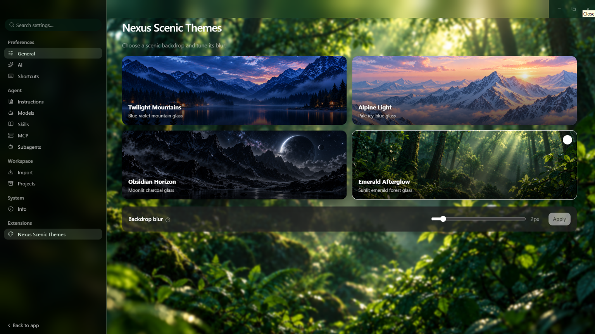
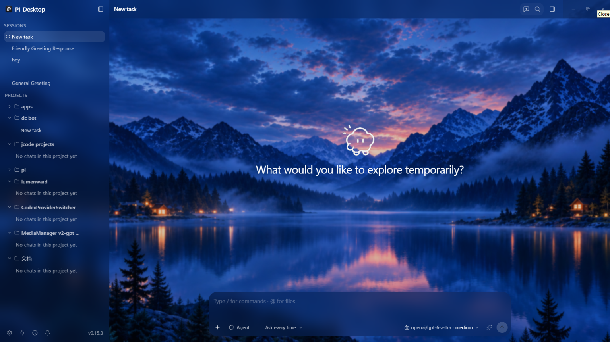
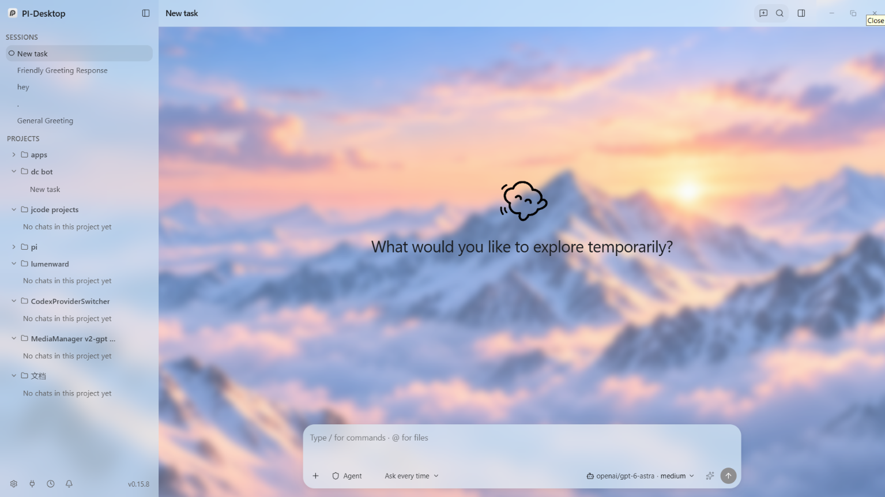
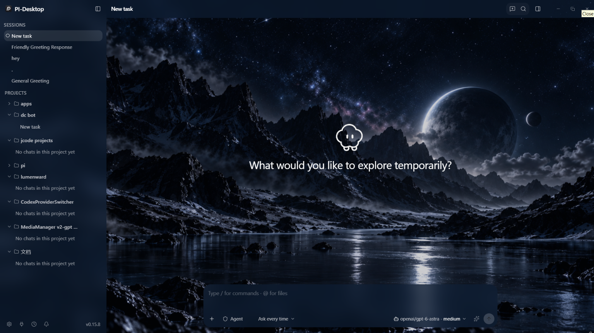
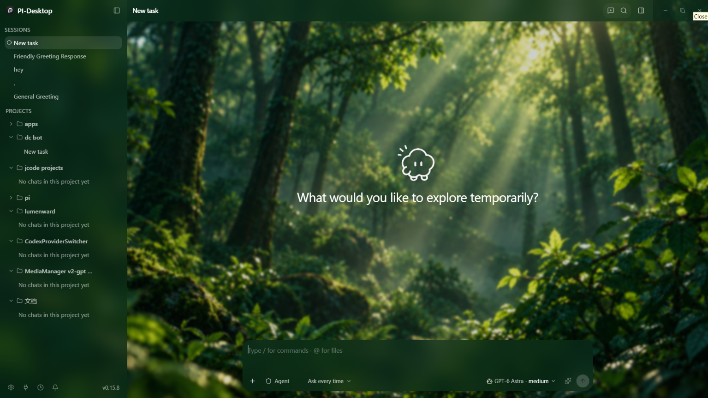

# Nexus Scenic Themes

An appearance theme pack for [PI-Desktop](https://github.com/vastsa/PI-Desktop). It adds four scenic themes from PI-Desktop Nexus to the native theme system.

Requires PI-Desktop 0.15.8 or later.

## Themes

- Twilight Mountains: blue-violet twilight mountain glass
- Alpine Light: pale icy-blue translucent glass
- Obsidian Horizon: moonlit charcoal and navy glass
- Emerald Afterglow: sunlit deep-emerald forest glass

| Twilight Mountains | Alpine Light |
| --- | --- |
|  |  |
| Obsidian Horizon | Emerald Afterglow |
|  |  |

## Settings

Open **Settings > Extensions > Nexus Scenic Themes** to select a theme and set its backdrop blur from 0px to 20px. Each theme retains its own blur value.

## Permissions

The plugin uses only `ui.theme`, `ui.settings`, and `ui.window.appearance`. All images are bundled locally; it does not use filesystem, network, shell, clipboard, agent tools, or background services.
